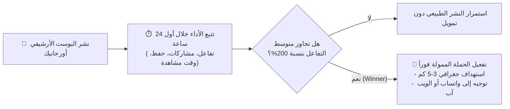

# 🚀 الدليل التشغيلي الموحد للسوشيال ميديا ومنظومة الأتمتة الشاملة — من الصفر للاحتراف
# (Fruit City Social Media Master Mission, AI Production & Omnichannel Automation SOP)
> **المسار:** `D:\fruit city project\التسويق والسوشيال ميديا\SOCIAL_MEDIA_MISSION_AND_SOP.md`  
> **الهدف:** التوثيق الشامل لمنظومة التسويق، الأتمتة، وصناعة المحتوى الرقمي لـ Fruit City: بدءاً من ضبط المنصات والأتمتة ذات المصدر الواحد، مروراً بإنتاج الصور والفيديوهات السينمائية بالذكاء الاصطناعي، وحتى تصدر الخوارزميات الطبيعية وهندسة الإعلانات الممولة الذكية.  
> **الموقع الجغرافي:** 64 شارع القصر العيني (أمام روزا اليوسف)، وسط البلد، القاهرة.  
> **المرجع المعتمد:** إسلام عاطف (صاحب المشروع) & Discovery-Driven AI Architect.  
> **المنهج الفكري:** عقلية المستكشف والتوسع الديناميكي (Explorer Mindset & Dynamic Scaling) بدون قوالب جامدة أو كليشيهات إنشائية.

---

## 🎯 1. خريطة المهمة الكبرى ومنظومة العمل الشاملة (The End-to-End Workflow)

```mermaid
flowchart TD
    DB["🗄️ 1. قاعدة البيانات المركزية ومحرك القصص\n(product-stories.json / POS Master)"] --> Sync["⚡ 2. أتمتة المزامنة الفورية (n8n & Scripts)\nتحديث الكاشير والـ Mini Web App لحظياً"]
    DB --> AI["🎨 3. خط أنابيب الذكاء الاصطناعي متعدد الأبعاد\n(توليد نصوص أرشيفية + صور 8K + فيديوهات سينمائية)"]
    
    AI --> Formats{"📐 4. المعايرة الآلية للمقاسات القياسية"}
    Formats -->|4:5 Feed Portrait| FB_IG["📘 📸 فيسبوك وإنستجرام"]
    Formats -->|9:16 Vertical Video| Reels["🎬 ريلز وتيك توك ويوتيوب Shorts"]
    Formats -->|2:3 Visual Pin| Pin["📌 بينتريست (Visual SEO)"]
    Formats -->|1:1 Square| Delivery["📍 خرائط جوجل + تطبيقات دليفري + المتجر"]
    
    Sync --> Pub["🚀 5. النشر المتزامن المخصص (APIs & Puppeteer)"]
    FB_IG --> Pub
    Reels --> Pub
    Pin --> Pub
    Delivery --> Pub
    
    Pub --> Algo["📈 6. تصدر الخوارزميات الطبيعية (Organic Dominance)\n(Watch Time / First 30 Min / No-Links in Post)"]
    Algo --> Winner{"📊 7. تقييم أول 24 ساعة:\nهل حقق المنشور تفاعلاً استثنائياً؟"}
    Winner -->|نعم (Winner Post)| Ads["📢 8. بروتوكول التمويل الذكي (Winner-Only)\nاستهداف 3-5 كم حول القصر العيني (واتساب / ويب آب)"]
    Winner -->|أداء اعتيادي| Archive["🏛️ حفظ في الأرشيف الطبيعي"]
```

---

## ⚡ 2. منظومة الأتمتة الشاملة ذات المصدر الواحد (Single-Trigger Omnichannel & POS Automation)

تعتمد Fruit City معمارية تشغيلية ثورية قائمة على **"المصدر الواحد للحقيقة (Single Source of Truth)"**؛ بحيث يؤدي أي إجراء فردي لإضافة صنف جديد، تعديل قصة تاريخية، أو إطلاق عرض ترويجي في ملف البيانات المركزي إلى إطلاق سلسلة أتمتة متكاملة تشمل كل مفاصل المشروع دون أي مجهود يدوي متكرر:

### أ. آلية الإطلاق والمزامنة اللحظية (The Single Trigger & Real-Time Sync):
1. **المحفز المركزي (The Central Trigger):**  
   إضافة أو تعديل أي منتج داخل قاعدة البيانات المركزية (ملف [`product-stories.json`](file:///D:/fruit%20city%20project/web_app/app_code/src/product-stories.json) أو واجهة إدارة المحل) يرسل إشارة تلقائية (Webhook / Event) عبر منصة الأتمتة المركزية **n8n** وسكربتات المشروع التشغيلية.
2. **المزامنة اللحظية للكاشير والمتجر (Zero-Latency POS & Web App Update):**
   * **نقاط البيع (POS):** تحديث فوري لقائمة الأصناف، الأسعار، والمكونات في نظام الكاشير المحلي (`database/fruit_city_production.db`) مع ضمان القفل الذري للمعاملات (Durable Single Writer).
   * **المتجر الرقمي (Mini Web App):** ينعكس التعديل لحظياً في واجهة العميل (`web_app/app_code`) مع ظهور كارت الصنف، أحجامه، وزر «اعرف القصة ↗» ثنائي اللغة (عربي / إنجليزي).

### ب. خط أنابيب الذكاء الاصطناعي متعدد الأبعاد (Multimodal AI Pipeline):
بمجرد اعتماد الصنف، يعمل خط إنتاج الذكاء الاصطناعي آلياً على تنفيذ 3 مهام متوازية:
1. **صياغة المحتوى والسرد التاريخي (Archival Copywriting):** استخراج القصة التاريخية الموثقة وصياغة هوك درامي مدعوم بالحقائق، وكتابة كابشن مخصص لكل منصة، مع مراعاة قواعد اللهجة المحلية الودودة.
2. **توليد وضبط الصور الأرشيفية (8K Ultra-Realistic Image Generation):** توليد صور فوتوغرافية سينمائية تُبرز الفاكهة الطبيعية والكوب الشفاف الأنيق الحامل للشعار الرسمي `Fruit City` بقطرات الندى الباردة، ثم قصها وضغطها آلياً بصيغة WebP و JPG عالية الجودة وفق المقاسات القياسية المعتمدة:
   * **`4:5` (1080 × 1350 px):** المقاس البورتريه المثالي لخوارزميات خلاصة فيسبوك وإنستجرام (Feed Posts).
   * **`9:16` (1080 × 1920 px):** المقاس الرأسي الكامل لريلز إنستجرام، فيسبوك، تيك توك، يوتيوب Shorts، وستوري واتساب.
   * **`2:3` (1000 × 1500 px):** المقاس القياسي الأمثل لمحرك البحث البصري Pinterest (Story Pins & Rich Pins).
   * **`1:1` (1080 × 1080 px / 800 × 800 px):** المقاس المربع لكروت المتجر الرقمي، تحديثات خرائط جوجل، ومنصات طلبات الطعام (Talabat / elmenus).
3. **إنتاج الفيديو القصير السينمائي (AI Short Video Generation):** تحويل المشاهد التاريخية والصور الفوتوغرافية إلى مقاطع فيديو ديناميكية مدتها (15-30 ثانية) بتقنيات الذكاء الاصطناعي (مثل Runway / Luma / Pika)، مع فويس أوفر سردي وثائقي ومؤثرات صوتية محيطية، وضبط الإيقاع ليكون خاطفاً في أول 3 ثوانٍ.

### ج. النشر المتزامن المخصص عبر الـ APIs والأتمتة المتصفحية (Publishing Engine):
توزيع المحتوى المُنتج تلقائياً وبشكل مخصص حسب طبيعة كل منصة:
1. **عبر الواجهات الرسمية (Official APIs):** النشر المباشر عبر Meta Graph API لحسابي فيسبوك وإنستجرام في نفس التوقيت المجدول.
2. **عبر أتمتة المتصفح (Headless Browser via Puppeteer / Playwright):** سكربتات أتمتة خفيفة ومستقرة تقوم بتسجيل الدخول ونشر التحديثات الدورية على المنصات التي لا توفر واجهات نشر مباشرة ومجانية (مثل رفع تحديثات العروض على Google Business Profile، أو جدولة الفيديوهات على تيك توك).
3. **حالات واتساب الأعمال (WhatsApp Business Status):** إرسال البوستر اليومي المخصص لرقم المحل المعتمد (`01025966033`) ليظهر لكافة جهات الاتصال النشطة كحالة يومية صباحية ومسائية.

---

## 📈 3. هندسة الخوارزميات الطبيعية وخوارزميات الإعلانات الممولة (Organic & Paid Ad Algorithms)

### أ. قواعد تصدر الخوارزميات الطبيعية (Organic Algorithm Dominance):
لكل منصة شفرة خوارزمية خاصة تجعلها تدفع بالمنشور لآلاف المستخدمين مجاناً عند استيفاء شروطها:

1. **فيسبوك (Facebook Algorithm Hacks):**
   * **قاعدة منع الروابط في متن البوست (No-Links in Post Body):** خوارزميات فيسبوك تعاقب أي بوست يحتوي على رابط خارجي بتقليل وصوله (Reach) بنسبة تصل إلى 70% لإبقاء المستخدم داخل التطبيق. لذلك يُمنع وضع رابط المتجر في المنشور؛ البديل المعتمد هو:
     * استخدام زر الإجراء الرسمي المباشر في المنشور (Send WhatsApp Message).
     * وضع رابط المتجر في **أول تعليق مثبت (Pinned First Comment)** مع دعوة في نهاية البوست: *"رابط المنيو والقصة كاملة في أول تعليق 👇"*.
   * **خوارزمية المشاركات الحقيقية (Real Shares Multiplier):** تركز خوارزمية فيسبوك على عدد مرات مشاركة المنشور (Shares) كأعلى إشارة جودة. القصص التاريخية غير المألوفة (مثل قصة تقديس المانجو 1968 أو سرقة شتلات الفراولة 1714) تدفع القارئ لمشاركة المعلومة كمعرفة طريفة، مما يضاعف الوصول الطبيعي 10 أضعاف البوستات البيعية التقليدية.

2. **تيك توك، ريلز، وشورتس (TikTok & Reels 3-Second Retention):**
   * **هوك الـ 3 ثوانٍ الأرشيفي (The 3-Second Visual & Audio Hook):** الفريم الأول يجب ألا يحتوي على لوجو ثابت أو مقدمة بطيئة. يبدأ الفيديو بصورة تاريخية وثائقية نادرة أو جملة صادمة بالصوت والصورة: *"أغرب فاكهة عبدوها وعملولها تماثيل في التاريخ!"*.
   * **معدل إكمال المشاهدة (Watch Time & Loop Ratio):** الهدف الأساسي للخوارزمية هو نسبة الذين يكملون الفيديو حتى النهاية أو يعيدون مشاهدته (Loop). جعل الفيديو مكثفاً وممتعاً بين 15 و 25 ثانية مع نهاية ترتبط بالبداية يرفع احتمالية إعادة تشغيله تلقائياً فيتعامل معه النظام كتريند فوري.

3. **بينتريست (Pinterest Visual SEO):**
   * معاملة بينتريست كمحرك بحث بصري وليس مجرد شبكة اجتماعية؛ استهداف كلمات مفتاحيّة دائمة الخضرة (Evergreen Visual Queries) مثل: *عصائر طبيعية، تقديم فواكه طازجة، مشروبات صحية، قصص تاريخية، مقهى عصائر القاهرة*.
   * وضع نصوص بديلة (Alt Text) ثرية بالكلمات المفتاحية ورابط مباشر لصفحة الصنف بالـ Mini Web App، لضمان تدفق زيارات عضوية مستمرة لشهور قادمة.

4. **خرائط جوجل والتصدر المحلي (Google Maps Local SEO):**
   * النطاق الجغرافي المركزي: **64 شارع القصر العيني (أمام روزا اليوسف)**.
   * إدراج صور منتجات دورية تحمل علامات جغرافية (Geo-Tagged Images) في نطاق القصر العيني ووسط البلد.
   * تضمين أسماء المناطق المحيطة المستهدفة في منشورات التحديث الأسبوعية (وسط البلد، جاردن سيتي، الزمالك، الدقي، السيدة زينب، المنيل).
   * حث الزبائن على كتابة مراجعات تتضمن أسماء العصائر المفضلة لرفع الترتيب في البحث المحلي (Local 3-Pack).

5. **منصات طلبات الطعام (Talabat & elmenus Conversion Optimization):**
   * تحسين معدل التحويل (CRO): زائر منصة الطعام شخص جائع أو عطشان بالفعل ومستعد للدفع؛ العامل الحاسم هنا هو **جاذبية الصورة** وعنوان الصنف.
   * استبدال الصور النمطية الباهتة بصور احترافية عالية التباين تبرز لون الفاكهة الطبيعي وبرودة الكوب، مع تضمين الهوك التاريخي المختصر في وصف الصنف داخل التطبيق لتمييز Fruit City عن جميع المنافسين.

---

### ب. بروتوكول الإعلانات الممولة الذكي (Winner-Only Ad Boosting Protocol):
الابتعاد الكامل عن العشوائية أو حرق الميزانيات على منشورات غير مختبرة؛ تحويل كل جنيه إعلاني إلى مبيعات مؤكدة:



1. **قاعدة المنشور الفائز فقط (Winner-Only Rule):**
   * يُمنع منعاً باتاً تمويل أي منشور بمجرد تصميمه.
   * يُطرح المنشور أولاً للجمهور الطبيعي؛ فإذا أثبتت أرقام أول 24 ساعة أنه حقق معدل مشاركات (Shares) واحتفاظ بالمشاهدة أعلى بنسبة ملحوظة من المتوسط، يُصنف كـ **"منشور رابح (Winner)"**.
2. **الاستهداف الجغرافي المصغر وفائق الدقة (Hyper-Local Geo-Fencing):**
   * حصر نطاق الإعلان بنصف قطر **3 إلى 5 كم فقط** كمركز انطلاق من مقر المحل: **64 شارع القصر العيني**.
   * المناطق المشمولة بالاستهداف الحصري:
     * **وسط البلد (Downtown Cairo)**
     * **جاردن سيتي (Garden City)** — ملاصق للفرع ومجتمع عالي القوة الشرائية.
     * **المنيل (El-Manial)** — محيط سكني وطلابي وطبي ضخم (مستشفيات القصر العيني).
     * **السيدة زينب (Sayyida Zeinab)** — كثافة سكانية وحركة تجارية نشطة.
     * **الزمالك (Zamalek)** — طلبات دليفري راقية ذات سلة طلبات مرتفعة (High AOV).
     * **الدقي (Dokki)** — مكاتب وشركات وسكان قريبين من كوبري الجلاء/الجامعة.
3. **الربط المباشر بمسار الشراء (Zero Friction Funnel):**
   * يربط الإعلان الممول مباشرة بـ:
     * إما **Click-to-WhatsApp** على الرقم المعتمد `01025966033` مع رسالة مجهزة مسبقاً باسم الصنف المعروض لسرعة الإغلاق والطلب.
     * أو رابط مباشر لصفحة الصنف على **Mini Web App** لطلب التوصيل بضغطة زر واحدة.
4. **توزيع الميزانية الإعلانية (Budget Allocation):**
   * **70% من الميزانية:** لحملات المبيعات والرسائل المباشرة الموجهة للفائزين (Direct Orders).
   * **30% من الميزانية:** لحملات الريلز والفيديوهات التاريخية واسعة الانتشار لبناء وترسيخ براند Fruit City كعلامة رائدة وفريدة في مصر.

---

## 🏛️ 4. بنك المصادر التاريخية الموثقة (Archival Sourcing Bank)

لضمان المصداقية التامة والابتعاد عن التأليف أو الأساطير غير المثبتة، تعتمد Fruit City على 4 مؤسسات أرشيفية دولية مفتوحة وموثقة كمرجعية دائمة لحكايات ورسومات الفواكه:

| المؤسسة الأرشيفية | طبيعة المحتوى والمصادر | الاستخدام العملي في المشروع |
| :--- | :--- | :--- |
| **Wikimedia Commons** | وثائق تاريخية، صور فوتوغرافية حرة، تراخيص المشاع الإبداعي، ومخطوطات نادرة. | التحقق من صور الأحداث السياسية والاجتماعية (مثل صور أحداث الصين 1968 ووثائق شحنات الفاكهة). |
| **Library of Congress** | الأرشيف الوطني الأمريكي، سجلات التجارة العالمية، وخرائط الرحلات الاستكشافية القديمة. | استخراج خرائط رحلات نقل شتلات الفاكهة وتجارة الموانئ في القرنين الثامن عشر والتاسع عشر. |
| **Biodiversity Heritage Library (BHL)** | أضخم مكتبة للتراث البيولوجي؛ تضم مئات آلاف الرسومات النباتية الأصلية (Botanical Art) النادرة. | استلهام درجات الألوان الطبيعية الحقيقية وتشريح ثمار الفواكه النادرة والتطريزات النباتية الكلاسيكية. |
| **Internet Archive** | كتب ومخطوطات ومجلات علمية وتاريخية قديمة من مختلف بلدان العالم. | تدقيق الروايات التاريخية لنشأة كل صنف ومراجعته مع المصادر العربية (المقريزي، ابن إياس، وبرديات الطب القديمة). |

* **بروتوكول الاعتماد والتدقيق:** لا يدخل أي صنف مرحلة الإنتاج التسويقي إلا بعد تأكيد روايته التاريخية بمصدرين على الأقل من هذا البنك وتوثيقهما في ملفات الحملة.

---

## ⚙️ 5. ضبط إعدادات المنصات الرسمية (Platform Settings & Optimization)

### 📘 أ. إعدادات صفحة فيسبوك الرسمية (Meta Business Suite):
1. **البيانات المعتمدة:**
   * **اسم الصفحة:** `Fruit city`
   * **معرّف الصفحة (Page ID):** `1416957214827583`
   * **معرّف البيزنس (Business ID):** `1436806248594308`
   * **رابط لوحة التحكم المباشرة:** [Meta Business Suite Dashboard](https://business.facebook.com/latest/home/?business_id=1436806248594308&asset_id=1416957214827583)
2. **التصنيف الأساسي (Category):** `Juice Bar` (محل عصائر ومشروبات) + `Fruit & Vegetable Store` (متجر فواكه وخضار).
3. **زر الإجراء الرئيسي (Action CTA Button):**  
   * تثبيت زر: **"إرسال رسالة واتساب (Send WhatsApp Message)"**.
   * مربوط بالرقم المعتمد: **`01025966033`**.
4. **العنوان والموقع الجغرافي:**  
   * **64 شارع القصر العيني (أمام روزا اليوسف)** مع تثبيت الدبوس بدقة على الخريطة لتوجيه العملاء القريبين تلقائياً.
5. **الردود التلقائية (Automated Instant Replies):**  
   *"أهلاً بيك في Fruit City! 🍹 طازة وطبيعي من قلب القصر العيني. لتصفح المنيو وقراءة حكاية كل صنف، أو لطلب أوردر سريع تواصل معنا عبر واتساب: 01025966033"*.

### 📸 ب. إعدادات حساب إنستجرام (Instagram Professional):
1. **نوع الحساب:** `Business Account` مربوط رسمياً بصفحة فيسبوك عبر Meta Accounts Center.
2. **البايو الاحترافي (Bio Optimization):**  
   * السطر 1: **Fruit City 🍓 وراء كل فاكهة حكاية تاريخية**  
   * السطر 2: **عصائر طبيعية فريش • فواكه مختارة بعناية**  
   * السطر 3: **📍 64 شارع القصر العيني (أمام روزا اليوسف)**  
   * السطر 4: **دليفري واتساب: 01025966033 | الرابط: رابط الـ Mini Web App**
3. **أغلفة الهايلايت (Highlights):**  
   *(📜 المنيو | 🥭 مانجو 1968 | 🏛️ التراث المصري | 💬 آراء وتجارب | 📍 موقعنا)*.

### 🎵 ج. إعدادات حساب تيك توك (TikTok Business):
* فئة `Food & Beverage`، تفعيل زر الواتساب وإدراج رابط المتجر في البايو.

---

## ✍️ 6. خط إنتاج المحتوى وصناعة البوسترات والفيديو (Content & Production SOP)

### الخطوة (1): صياغة المحتوى والكابشن (في مجلد `content/`)
* **الهوك التاريخي الصادم (The Archival Hook):** افتتاحية توثيقية تجذب الانتباه خلال ثانيتين بدون مبالغات إنشائية:  
  *(مثال: "في أغسطس 1968.. أهدى وزير خارجية باكستان قفص مانجو لبكين، فتحولت الفاكهة لرمز مقدس وطافت بيها طيارات خاصة!")*.
* **الوصف الحسي الطبيعي:** التعبير عن ثراء الفاكهة وأليافها الطبيعية الطازجة وبرودتها المنعشة بأسلوب راقٍ وواقعي.
* **الدعوة للتفاعل والشراء (CTA):** سؤال يثير الفضول حول الرواية، مع توجيه صريح للطلب عبر واتساب أو المتجر.
* **الهاشتاجات الموضعية المحصورة:**  
  `#Fruit_City #عصائر_طبيعية #القصر_العيني #وسط_البلد #جاردن_سيتي #الزمالك #المنيل #مانجو1968 #تاريخ_الفاكهة`

### الخطوة (2): التصميم البصري وإنتاج الفيديو (في مجلدات `images/` و `videos/`)
* **الكوب كبطل حقيقي:** كوب شفاف وأملس يُبرز نقاء ولون الفاكهة الطبيعية بقطرات ندى التبريد العضوية، يتوسطه الشعار المعتمد `Fruit City` بكبسولته الحمراء `Healthy Juice`.
* **لوحة الألوان المعتمدة (Design Tokens):**  
  خلفية دافئة `#faf9f4`، أخضر تراثي `#183e2d`، برتقالي حيوي `#dc7a2b`، وقرمزي الشعار `#792b29`.
* **التسكين الآلي للأصول:** تصدير كافة المقاسات وتسكينها تلقائياً داخل المجلدات المخصصة لها بكل منصة.

---

## ⏱️ 7. أسرار التوقيت الذهبي والتفاعل الحي (Posting Schedule & Live Velocity)

1. **أوقات النشر الذهبية في القاهرة:**  
   * **ذروة الانتعاش النهارية (2:00 ظهراً - 4:30 عصراً):** تزامناً مع خروج الموظفين والطلاب والحرارة.
   * **ذروة التسلية المسائية (8:00 مساءً - 11:30 مساءً):** أعلى وقت تفاعل وتصفح وطلبات مسائية.
2. **قاعدة الـ 30 دقيقة الذهبية (The 30-Minute Engagement Velocity):**  
   * متابعة البوست في أول نصف ساعة من نشره والرد الفوري على كافة التعليقات بأسئلة تفاعلية ذكية لدفع الخوارزميات نحو توسيع دائرة الاقتراح العضوي.
3. **الريلز المستمر (Reels Frequency):**  
   * نشر من 3 إلى 5 مقاطع ريلز وفيديو قصير أسبوعياً لضمان النمو المستمر للحساب وجذب زبائن جدد خارج دائرة المتابعين الحاليين.
