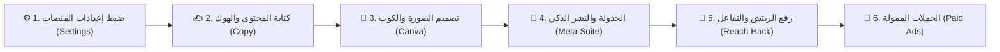

# 🚀 دليل المهمة التشغيلية الشاملة للسوشيال ميديا — من الصفر للاحتراف
# (Fruit City Social Media Master Mission & SOP: A to Z)
> **المسار:** `D:\fruit city project\التسويق والسوشيال ميديا\SOCIAL_MEDIA_MISSION_AND_SOP.md`  
> **الهدف:** توثيق رحلة المهمة التسويقية لفاكهة سيتي بالكامل: من إعدادات المنصات وضبط الحسابات، مروراً بصناعة المحتوى والتصميم، وحتى النشر الصحيح لخوارزميات Meta وإدارة الإعلانات الممولة.  
> **المرجع المعتمد:** إسلام (صاحب المشروع) & AntiGravity.

---

## 🎯 1. خريطة المهمة الكبرى (The End-to-End Mission Workflow)

---

## ⚙️ 2. ضبط إعدادات المنصات لخدمة الصفحة والمحل (Platform Settings & Optimization)

قبل نشر أي بوست، يجب تهيئة "الماكينة" التي ستستقبل الزبائن؛ إعدادات المنصة الصحيحة هي التي تجعل الخوارزميات تقترح صفحتك للناس القريبة منك:

### 📘 أ. إعدادات صفحة فيسبوك (Meta Business Suite):
1. **اسم الصفحة ومعرّفاتها الرسمية (تم اعتمادها من الحساب المباشر):**
   * **اسم الصفحة:** `Fruit city`
   * **معرّف الصفحة (Page ID):** `1416957214827583`
   * **معرّف البيزنس (Business ID):** `1436806248594308`
   * **رابط لوحة التحكم المباشرة:** [Meta Business Suite Dashboard](https://business.facebook.com/latest/home/?business_id=1436806248594308&asset_id=1416957214827583)
2. **التصنيف الأساسي (Category):** `Juice Bar` (محل عصائر ومشروبات) + `Fruit & Vegetable Store` (متجر فواكه وخضار).
3. **زر الإجراء الرئيسي (Action CTA Button):**  
   * تثبيت زر: **"إرسال رسالة واتساب (Send WhatsApp Message)"**.
   * ربطه برقم المحل والطلبات المعتمد: **`01025966033`**.
4. **العنوان والموقع الجغرافي (Location & Map):**  
   * وضع الدبوس (GPS Pin) بدقة متناهية على مقر المحل، لأن خوارزميات فيسبوك تقترح البوستات أوتوماتيكياً للناس المتواجدة في نطاق المحل (Local Search).
5. **ساعات العمل والورديات:** تسجيل مواعيد العمل (مثال: يومياً من 9:00 ص إلى 2:00 ص) لتظهر علامة "مفتوح الآن (Open Now)".
6. **الردود التلقائية والترحيبية (Automated Instant Replies):**  
   * بمجرد إرسال الزبون لأي رسالة، يصله رد فوري بلمسة ترحيبية:  
     *"أهلاً بيك في فاكهة سيتي! 🍹 طازة وطبيعي 100%. لتحميل المنيو والأسعار أو طلب دليفري سريع كلمنا واتساب: 01025966033"*.
   * إعداد الأسئلة الشائعة (FAQs): (أين موقعكم؟ / هل في دليفري؟ / ما هي عروض اليوم؟).

### 📸 ب. إعدادات حساب إنستجرام (Instagram Professional):
1. **نوع الحساب:** تحويله إلى **Business Account** وربطه مباشرة بصفحة الفيسبوك عبر Meta Accounts Center.
2. **البايو الاحترافي (Bio Optimization):**  
   * السطر 1 (الهوية): *فاكهة سيتي 🍓 الطبيعي على أصوله من 1968*.  
   * السطر 2 (التميز): *عصائر بيور 100% بدون مياه أو سكر + فواكه طازجة*.  
   * السطر 3 (الطلب واللوكيشن): *📍 فرعنا يرحب بكم | دليفري واتساب: 01025966033*.  
   * السطر 4 (الرابط): رابط متجر الويب آب المباشر.
3. **أغلفة الهايلايت (Highlights):** تنظيم 5 هايلايت رئيسية بأيقونات موحدة:  
   *(📜 المنيو | 🥭 مانجو 1968 | 🥑 المكسات | 💬 آراء الزبائن | 📍 الموقع والفرع)*.

### 🎵 ج. إعدادات حساب تيك توك (TikTok Business):
1. فتح حساب تجاري واختيار فئة `Food & Beverage`.
2. تفعيل خيار الاتصال والواتساب وإضافة رابط الويب آب في البايو بمجرد وصول الحساب للشروط.

---

## ✍️ 3. خط إنتاج البوست: من الفكرة حتى النشر (Content-to-Post Pipeline)

### الخطوة (1): تجهيز المحتوى والكابشن (في مجلد `content\`)
* **الهوك الصادم (The Hook):** أول سطرين هما الفيصل في إيقاف العميل عن السكرول:  
  *(مثال: "في سنة 1968 اتعصر أول كاس مانجو بالطريقة دي.. والسر فضل مدفون لحد النهاردة!")*.
* **نص الرواية الحسي:** وصف القوام، القطع، والانتعاش الطبيعي بدون مياه ولا سكر.
* **دعوة للتفاعل (CTA):** *(منشن لصاحبك اللي مبيشربش غير مانجا / أو اكتب "مانجو" في كومنت وهيجيلك المنيو والأسعار في رسالة)*.
* **الهاشتاجات الموضعية (Geotargeted Hashtags):**  
  مكس مدروس بين هاشتاجات عامة ومحلية:  
  `#فاكهة_سيتي #عصير_طبيعي #مانجو1968 #عصائر_فريش #مصر #القاهرة` + هاشتاج المنطقة الجغرافية للفرع.

### الخطوة (2): تجهيز الصورة والبوستر (في مجلد `images\`)
* استخدام مقاس المنصة الصحيح (فيسبوك مربع `1080×1080`، إنستجرام بورتريه `1080×1350`).
* الالتزام الصارم بوجود: **كوب فاكهة سيتي الحقيقي المعتمد بالشعار**، وألوان البراند المبهجة.

---

## 🚀 4. أسرار كسر خوارزميات Meta للوصول لأعلى ريتش (Reach Optimization)

للحصول على أقصى وصول أورجانيك (مجاني) بدون إعلانات:
1. **أوقات النشر الذهبية (Posting Time Optimization):**  
   * **ذروة العطش والانتعاش:** من الساعة 2:00 ظهراً إلى 4:00 عصراً (وقت خروج الموظفين والحرارة).  
   * **ذروة التسلية المسائية:** من الساعة 8:00 مساءً إلى 11:30 مساءً (أعلى وقت تواجد على السوشيال ميديا في مصر).
2. **قاعدة الـ 30 دقيقة الذهبية (The First 30-Minute Rule):**  
   * أول نصف ساعة بعد نزول البوست هي التي تحدد مصيره عند خوارزميات Meta.  
   * يجب على فريق المحل الرد على **كل كومنت فوراً** بسؤال لإشعال النقاش، لأن كل رد يُحسب تفاعلاً إضافياً يدفع فيسبوك لاقتراح البوست لآلاف غيرهم.
3. **تنسيق Meta Business Suite:**  
   * عدم النشر من زر المشاركة العادي في الموبايل؛ بل النشر المجدول من **Meta Business Suite** على الكمبيوتر مع وضع الـ Tag للفرع وتفعيل ميزة الـ Crossposting المتزامن بين FB و IG.
4. **استخدام الريلز (Reels):**  
   * خوارزميات إنستجرام وفيسبوك تعطي الأولوية المطلقة للريلز (9:16)؛ نشر 3 مقاطع ريلز أسبوعياً يرفع ريتش الصفحة بنسبة 300%.

---

## 📢 5. منظومة الإعلانات الممولة (Meta Ads Strategy: A Separate Game)

الإعلانات الممولة قصة احترافية مستقلة تهدف إلى **تحويل كل جنيه مصروف إلى أوردرات حقيقية وأرباح**:

### أ. أنواع الحملات المعتمدة لفاكهة سيتي:
1. **حملات رسائل الواتساب (Click-to-WhatsApp Ads):**  
   * أنجح وأسرع نوع إعلان للمطاعم ومحلات العصير.  
   * البوست يعرض العصير أو علبة الفواكه القطع مع زر "واتساب"، العميل يضغط يدخل يطلب أوردره في شات الواتساب فوراً.
2. **حملات الوصول المحلي (Local Awareness / Reach):**  
   * استهداف دائري بقطر 3 إلى 5 كم فقط حول عنوان المحل لضمان سرعة التوصيل وسخونة الطلب.
3. **حملات إعادة الاستهداف (Retargeting):**  
   * استهداف كل من تفاعل مع الصفحة أو دخل على الويب آب خلال آخر 30 يوماً بعرض الويك إند أو خصم خاص.

---

## ⚡ 6. استراتيجية النشر الموحد المتزامن (1-Click Omnichannel Publishing Engine)
> **رؤية المالك (إسلام):** ربط جميع المنصات أونلاين ببعضها بحيث يتم تصميم ونشر البوست أو الريلز أو العرض مرة واحدة فقط، ويتم توزيعه ونشره آلياً على كافة المنصات في نفس اللحظة:

1. **المحور المركزي (Meta Business Suite):**
   * ربط صفحة `Fruit city` بحساب `Instagram`.
   * أي منشور، قصة (Story)، أو مقطع (Reel) يتم نشره يذهب تلقائياً لكلا المنصتين بضغطة زر واحدة `[✔ FB + ✔ IG]`.
2. **تحديثات خرائط جوجل (Google Maps Updates & Local Posts):**
   * المنشورات الترويجية والعروض يتم ترحيلها مباشرة كـ "تحديث عرض / منتج" على ملف Google Maps لرفع الترتيب المحلي (Local SEO) وجذب الزبائن القريبة.
3. **فيديوهات تيك توك (TikTok Reels/Shorts):**
   * مقاطع الفيديو والريلز (صيغة 9:16) يتم جدولتها بالتوازي للانتشار السريع والتريندات.
4. **حالات واتساب الأعمال (WhatsApp Business Status):**
   * نشر بوستر العصير اليومي على ستوري واتساب لرقم `01025966033` لاستهداف الزبائن المسجلين.

### ب. خطة إدارة الميزانيات:
* تخصيص 70% من الميزانية لحملات الرسائل والطلبات المباشرة (Direct Sales).
* تخصيص 30% لحملات الفيديو والريلز لبناء اسم وبراند "فاكهة سيتي" في المنطقة.
